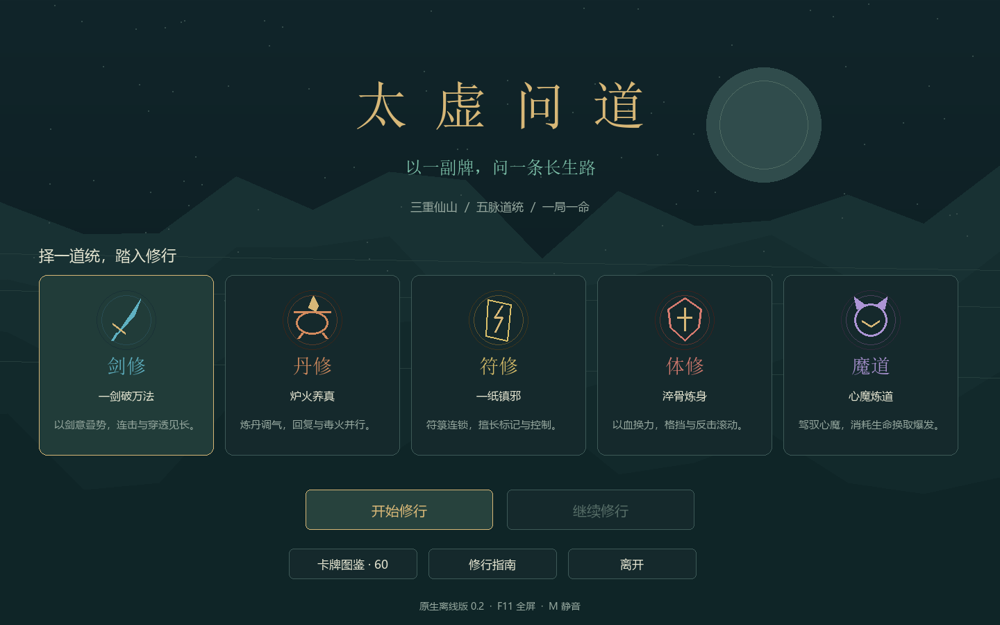
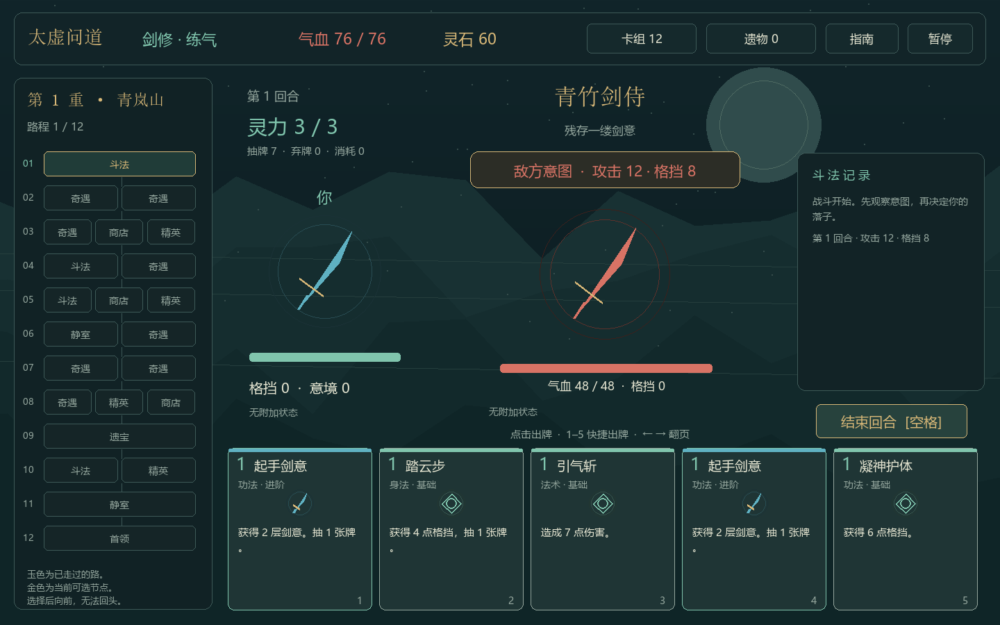

# 太虚问道（Taixu Ascension）

东方修真题材的 Roguelike 构筑式卡牌游戏，使用 pygame-ce / SDL 原生桌面窗口。当前版本 **0.2.0**，可完成三重地图的一整局流程。目标平台为 Windows 10 / 11 64 位。

## 游戏内容

- 五个流派：剑修、丹修、符修、体修、魔道。
- 60 张卡牌，包含法术、功法、身法、丹药和天劫，每张可升级一次。
- 三重地图，每重 12 步，包含战斗、精英、奇遇、商店、静室、遗宝和首领。
- 15 种普通敌人、强化精英变体、3 位首领、24 件遗物和 12 个事件。
- 练气、筑基、金丹、元婴、化神五个境界；卡组构筑、升级与移除。
- 自动存档、战斗中读档、卡牌图鉴、全屏与静音。





## 直接开始游戏

完整解压项目 ZIP，进入 `taixu-ascension` 文件夹，双击根目录的 `TaixuAscension.exe`。程序已包含 Python 运行环境和内容数据，无需安装 Python 或依赖，支持 Windows 10 / 11 64 位。

根目录程序对应版本 **0.2.0**。修改源码后，重新执行构建脚本，将 `dist/TaixuAscension.exe` 复制到根目录以更新随仓库附带的程序。

## 从源码运行

准备 **Python 3.14（64 位）**，在项目根目录打开 PowerShell：

```powershell
python -m venv .venv
.\.venv\Scripts\python.exe -m pip install -r requirements.txt
.\.venv\Scripts\python.exe main.py
```

使用虚拟环境的 Python 完整路径，无需激活环境。游戏离线运行；安装依赖时需要网络。

## 测试

```powershell
.\.venv\Scripts\python.exe -m unittest discover -s tests -p test_engine.py
.\.venv\Scripts\python.exe scripts/verify_ui.py
```

第一条运行 27 项规则回归，第二条在 SDL 无显示器模式校验快捷键、暂停、静音与卡牌详情界面。测试存档写入临时目录，不会覆盖玩家存档。

## 构建 Windows 可执行文件

```powershell
.\.venv\Scripts\python.exe -m pip install -r requirements-dev.txt
powershell -NoProfile -ExecutionPolicy Bypass -File scripts/build.ps1 -Python .\.venv\Scripts\python.exe
```

构建脚本先执行规则与界面检查，再生成：

- `dist/TaixuAscension.exe`：自带 Python 运行环境和内容数据的原生程序。
- `dist/TaixuAscension-Windows.zip`：程序、项目说明、操作说明和依赖说明。

玩家解压 Windows 构建包后双击 `TaixuAscension.exe`，无需另装 Python。

## GitHub 上传与自动构建

本项目包可直接作为新仓库的根目录，不需要已有 Git 历史。

1. 解压项目 ZIP，在 GitHub 创建空仓库，仓库名建议 `taixu-ascension`。
2. 使用网页的 **Add file → Upload files**，上传本目录内的全部文件和文件夹；确认包含 `.github`、`.gitignore`、`.gitattributes` 等以点开头的项目文件。不要只上传项目 ZIP，ZIP 内的文件需要展开后进入仓库。
3. 提交后在 **Actions** 查看 `Windows 原生构建`。流程执行规则测试、界面检查并打包 Windows 程序。
4. 在成功运行页面的 **Artifacts** 下载 `TaixuAscension-Windows`。

如使用 Git，可在项目根目录执行以下命令，将 `YOUR_ACCOUNT` 和仓库名替换为实际值：

```powershell
git init -b main
git add .
git commit -m "Initial native desktop prototype"
git remote add origin https://github.com/YOUR_ACCOUNT/taixu-ascension.git
git push -u origin main
```

提交不会自动发布 GitHub Release；流程产物保留 14 天。手动发布版本的步骤见 [GitHub 上传说明](docs/GITHUB.md)。

## 目录

```text
.
├── main.py                  原生窗口、绘制和输入
├── TaixuAscension.exe        可直接双击运行的 Windows 程序
├── engine.py                战斗规则、地图、奖励、经济与存档
├── content.json             卡牌、流派、普通敌人与首领数据
├── app.ico                  应用图标
├── requirements.txt         游戏运行依赖
├── requirements-dev.txt     测试与打包依赖
├── tests/                   规则回归
├── scripts/                 构建和界面检查
├── docs/                    操作、开发、验证与截图
└── .github/workflows/       Windows CI 构建
```

遗物与事件当前定义在 `engine.py`；新增卡牌效果需要修改内核。具体结构见 [开发说明](docs/DEVELOPMENT.md)。

## 操作与存档

点击手牌或按 1–5 出牌，空格结束回合，Esc 暂停，F11 全屏，M 静音。详细规则见 [操作说明](docs/PLAYING.md)。

每次行动自动存档到 `%LOCALAPPDATA%\TaixuAscension`。开发时可通过 `--save-dir` 使用独立存档目录：

```powershell
.\.venv\Scripts\python.exe main.py --save-dir .local/save
```

## 当前开发边界

这是原生可玩原型。商业美术、配乐、多敌人战斗、进阶难度、附魔与强化分支、成就、云存档和控制器适配尚未实现。单局 30–50 分钟与长期平衡仍需真人测试。

验证结果见 [验证记录](docs/VALIDATION.md)，第三方组件说明见 [依赖说明](docs/THIRD_PARTY.md)。
